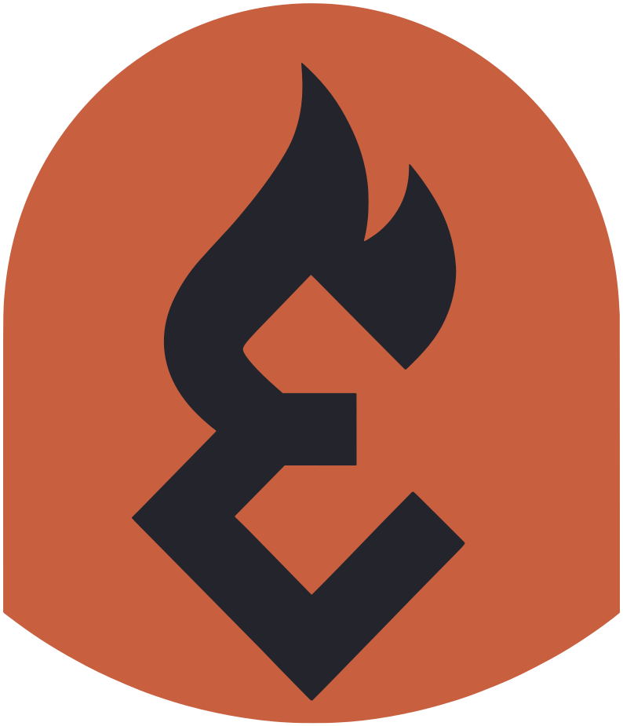

<p align="center"></p>

# ergon

A personal Fedora Atomic (bootc) image built on [Universal Blue](https://universal-blue.org)'s
`base-main`: the [niri](https://github.com/niri-wm/niri) scrolling compositor with the
[Noctalia](https://noctalia.dev) shell, Qt/KDE apps, and Steam. It stays close to stock
Fedora (stock kernel, ublue's codec-complete Mesa) so it should be about as stable as Kinoite.

Built from [ublue-os/image-template](https://github.com/ublue-os/image-template).

## What's in it

| Area | Packages |
|---|---|
| Base | `ghcr.io/ublue-os/base-main:44` (Fedora 44, no desktop) |
| Desktop | niri, Noctalia v5 (bar, launcher, notifications, lock screen, idle, clipboard, polkit agent), xwayland-satellite |
| Login | greetd + [noctalia-greeter](https://github.com/noctalia-dev/noctalia-greeter) (from Terra; Starship is the only other Terra package) |
| Portals | GNOME (screencast/screenshot), KDE (file dialogs), GTK; config in `/etc/xdg-desktop-portal/niri-portals.conf` |
| Apps | kitty, Dolphin, Kate, KWrite, Ark, Gwenview, VLC, KCalc, btop, KDE Partition Manager, KWallet, CoreCtrl |
| Theming | ergon palette for Noctalia (from the logo), applied to Qt/KDE, kitty, GTK, btop and Firefox through Noctalia's templates; qt6ct + Kvantum, Breeze style; Papirus-Dark icons with terracotta folders; Bibata Modern Classic cursor; `QT_QPA_PLATFORMTHEME=qt6ct` set session-wide |
| Branding | ergon Plymouth boot splash, wallpapers in `/usr/share/backgrounds/ergon`, greeter palette and wallpaper, fastfetch logo, `os-release` URLs/colour |
| Shell | [Starship](https://starship.rs) prompt: short path, git branch/status, `user@host` only over SSH, coloured from the Noctalia palette; fastfetch with the ergon logo |
| Gaming | Steam (negativo17), steam-devices, gamescope, gamemode, MangoHud; ProtonUp-Qt (Flatpak) |
| Fonts | Noto Sans, Noto Color Emoji, JetBrains Mono |

## Default keybinds

niri's defaults, except:

| Keys | Action |
|---|---|
| `Mod+T` | kitty |
| `Mod+E` | Dolphin |
| `Mod+Space` / `Mod+D` | Noctalia launcher |
| `Mod+S` | Control center |
| `Mod+X` | Session menu (lock, logout, reboot, shutdown) |
| `Mod+N` | Notifications |
| `Mod+Ctrl+V` | Clipboard history |
| `Mod+Shift+Comma` | Noctalia settings |
| `Alt+Tab` | Window switcher |
| `Super+Alt+L` | Lock |
| `Mod+Shift+S` | Region screenshot (Noctalia); `Print` keeps niri's screenshot UI |
| Volume / media / brightness keys | via Noctalia, with its OSD |

`Mod+Shift+/` shows the hotkey overlay. The system config is `/etc/niri/config.kdl`; niri prefers
`~/.config/niri/config.kdl`, so copy it there to customise it.

## Setup (once)

The repo is [Gateshare/ergon](https://github.com/Gateshare/ergon) (private), and the image is
published as `ghcr.io/gateshare/ergon`.

1. Create a signing key (the build fails without one). Never commit `cosign.key`, which is gitignored.
   ```bash
   COSIGN_PASSWORD="" cosign generate-key-pair
   gh secret set SIGNING_SECRET --repo Gateshare/ergon < cosign.key
   git add cosign.pub && git commit -m "Add cosign public key" && git push
   ```
2. Wait for the **Build container image** workflow to go green. It also rebuilds daily at 10:05 UTC
   to pick up Fedora and base-image updates.

### CI runners

Both workflows run on Gateshare's **self-hosted** runners (`runs-on: [self-hosted, linux, x64]`), not
GitHub-hosted ones. To target a specific runner, add its label to that list in both workflow files.

The runners have Docker but not podman, so the image build runs **inside the official podman
container** (`quay.io/podman/stable`, privileged) and nothing is installed on the host. The job
installs its own `git` and `jq` in that container. Podman's storage is the named Docker volume
`ergon-podman-storage`, which keeps the base image cached between builds; each build deletes its
own images at the end. The host needs:

- Docker, usable by the runner user, with privileged containers allowed
- About **50 GB free** for Docker (each build makes an ~8 GB image plus a rechunked copy)
- To reclaim the cache entirely: `docker volume rm ergon-podman-storage`

The template's "maximize build space" step, which deletes preinstalled software, is removed
because it would modify the runner machine.

**Disk images (ISO/qcow2)** still expect podman and passwordless `sudo` on the runner host, because
bootc-image-builder runs as root, so the **Build disk images** workflow doesn't work on these runners yet.
Build ISOs locally with `just build-iso` in the meantime.

## Install

The package is private, so each machine needs a GitHub token with `read:packages` before it can pull.
A classic personal access token works:

```bash
sudo install -m 0600 /dev/stdin /etc/ostree/auth.json <<'EOF'
{ "auths": { "ghcr.io": { "auth": "<base64 of github-username:token>" } } }
EOF
```

Then, from an existing Fedora Atomic / Universal Blue install (Kinoite, Bazzite, ...):

```bash
sudo bootc switch ghcr.io/gateshare/ergon:latest
systemctl reboot
```

Alternatively, make the GHCR package public (package settings → visibility) and skip the token.
The repo itself can stay private.

The previous deployment stays in the boot menu for rollback (`sudo bootc rollback`).

To test it first in a VM, build locally and boot a qcow2 (needs `just` and podman):

```bash
just build && just build-vm && just run-vm
```

## After the first boot

- **Login**: greetd shows the Noctalia greeter with ergon's palette and wallpaper. To sync your own
  wallpaper and colours to it, run `noctalia msg greeter-sync`.
- **Theme**: Noctalia starts on the `ergon` palette (`~/.config/noctalia/palettes/ergon.json`, selected in
  `~/.config/noctalia/ergon.toml`) and the ergon wallpaper. Anything you pick in Noctalia's settings overrides
  those. Its templates write the palette into KDE/Qt (KColorScheme, which qt6ct loads), kitty, GTK and btop.
  ergon defaults to the Breeze style. Kvantum is installed, but Kvantum themes bring their own colours and
  override Noctalia's palette.
- **Bar**: workspaces on the left; date and time in the middle; CPU, RAM, network speed, then the usual
  status icons on the right. CPU and RAM turn yellow above 80 % and red from 90 % (a small Noctalia plugin in
  `/usr/share/ergon/noctalia-plugins/sysmon`). There are no launcher, wallpaper, control-center or session
  buttons: use `Mod+Space`, `Mod+S` (or right-click the bar) and `Mod+X`.
- **Prompt**: Starship, configured in `~/.config/starship.toml`. Noctalia's `starship` template keeps the
  palette block at the end of that file in sync with the theme. Set `ergon_starship_disable=1` early in
  `~/.bashrc` to go back to Fedora's prompt.
- **Firefox** (the RPM, not the Flatpak): the Pywalfox extension is installed by policy, and Noctalia's
  `pywalfox` template themes Firefox with the palette. Restart Firefox once after the first login.
- **KWallet**: to have it unlock at login, create a wallet named `kdewallet` (Blowfish) with
  your login password in KWallet Manager.
- **CoreCtrl**: ergon adds the kernel argument `amdgpu.ppfeaturemask=0xffffffff` (via
  `/usr/lib/bootc/kargs.d`) so fan curves, power limits and clocks are adjustable. Remove that file
  if you don't want it.
- **Flatpaks**: on boot, `ergon-flatpaks.service` installs the apps listed in
  `/usr/share/ergon/flatpaks.list` from Flathub, and re-runs only when the list changes.
- **Per-user defaults** (Noctalia palette, theme and bar, Starship, qt6ct, Dolphin's terminal = kitty, Papirus-Dark icons)
  are copied from `/usr/share/ergon/user-defaults` into your home at login, without overwriting anything that
  exists. To pick up a newer default, delete your copy (for example `~/.config/qt6ct/qt6ct.conf`) and log in again.

## Layout

```
Containerfile              FROM base-main:44, runs build_files/build.sh
build_files/build.sh       package installs, Terra greeter, branding, service enablement
system_files/              copied onto / after packages are installed
  etc/niri/config.kdl          system niri config (niri default + "ergon:" changes)
  etc/greetd/config.toml       greetd -> noctalia-greeter-session
  etc/xdg-desktop-portal/      portal routing for niri
  etc/profile.d/ergon-prompt.sh  starts Starship (falls back to a short Fedora prompt)
  etc/xdg/fastfetch/           fastfetch config (ergon logo)
  etc/dconf/db/distro.d/       GTK icon/cursor/font defaults
  etc/firefox/policies/        installs the Pywalfox extension
  usr/lib/...                  services, tmpfiles, environment.d, bootc kargs
  usr/share/ergon/             Flatpak list, per-user default config, greeter appearance, Noctalia plugin
  usr/share/plymouth/themes/   ergon boot splash
branding/                  ergon emblem (full colour + single-colour cut-out)
  generate.py                  renders wallpapers/, plymouth/ and fastfetch/ from the emblem
  wallpapers/, plymouth/, fastfetch/  rendered output (committed; the build only copies it)
image-template.env         image name / org used by the Justfile and CI
```

## Updating

- **Packages**: edit the arrays in `build_files/build.sh`.
- **Fedora release**: bump `base-main:44` in the `Containerfile` and the `PRETTY_NAME` line in `build.sh`.
  Renovate opens a PR for new base tags.
- **Branding**: after changing `branding/ergon-emblem.svg` or `generate.py`, run `python3 branding/generate.py`
  (needs ImageMagick with librsvg, numpy, scipy and Pillow) and commit the output. The boot splash theme is
  `system_files/usr/share/plymouth/themes/ergon`; `build.sh` rebuilds the initramfs so it takes effect.
- **Bibata cursor**: bump `bibata_version` and `bibata_sha256` in `build.sh`.
- After changing `system_files/etc/niri/config.kdl`, check it with `niri validate -c system_files/etc/niri/config.kdl`.
